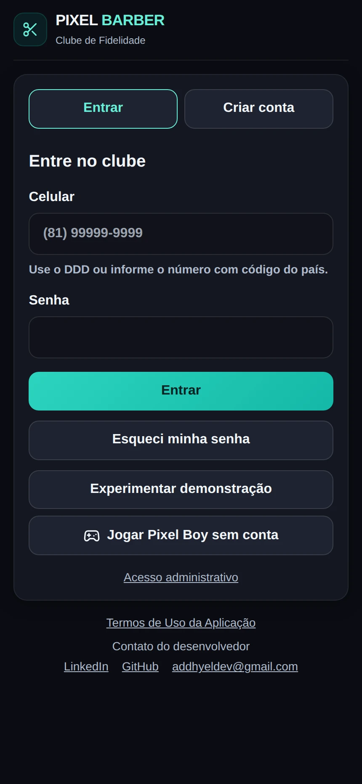
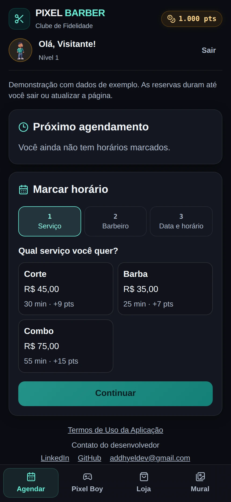
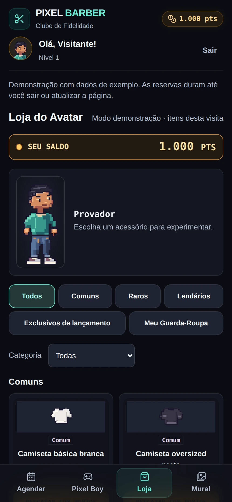
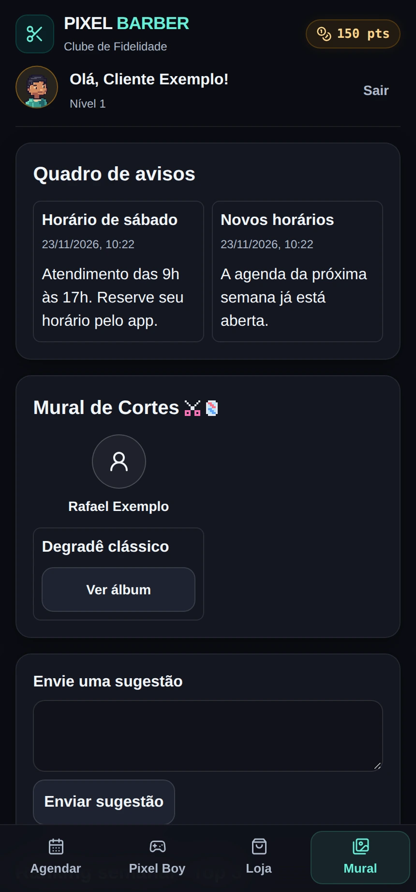
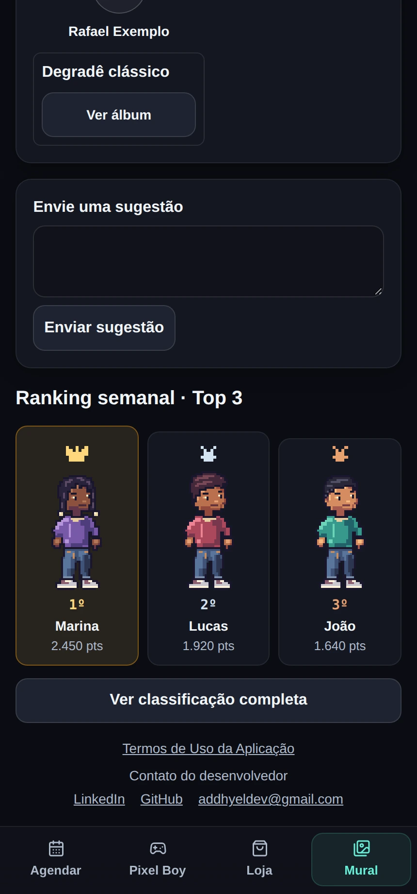
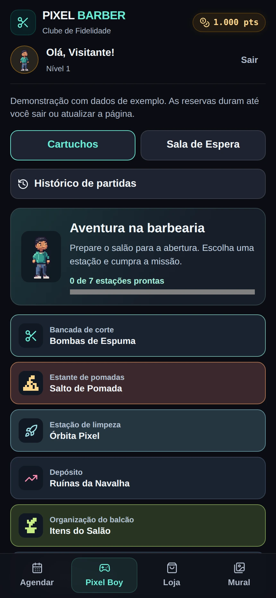
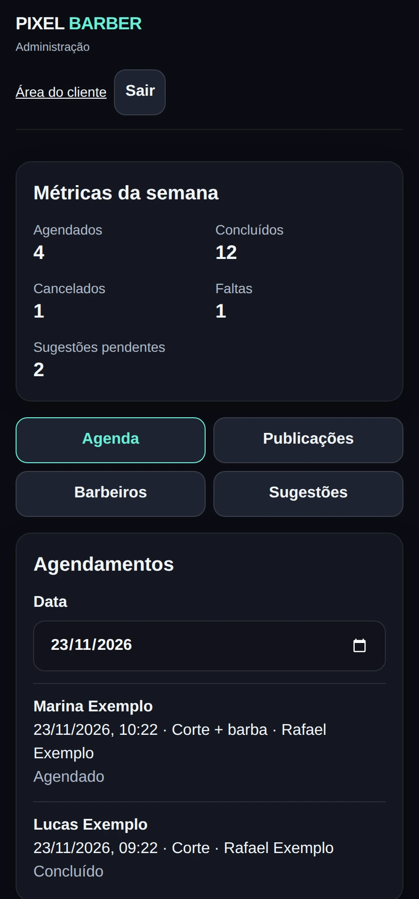
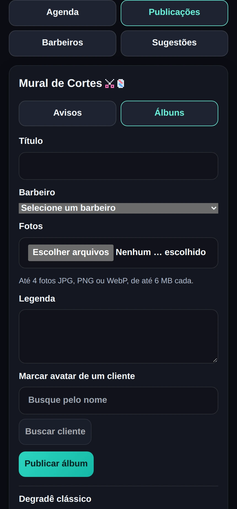
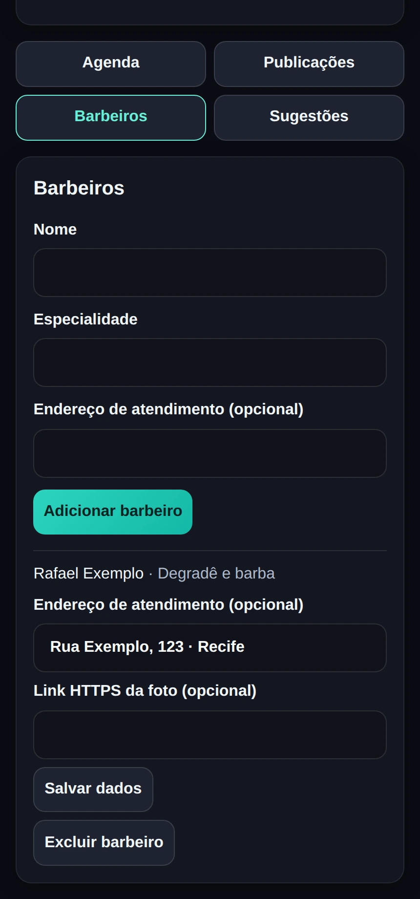
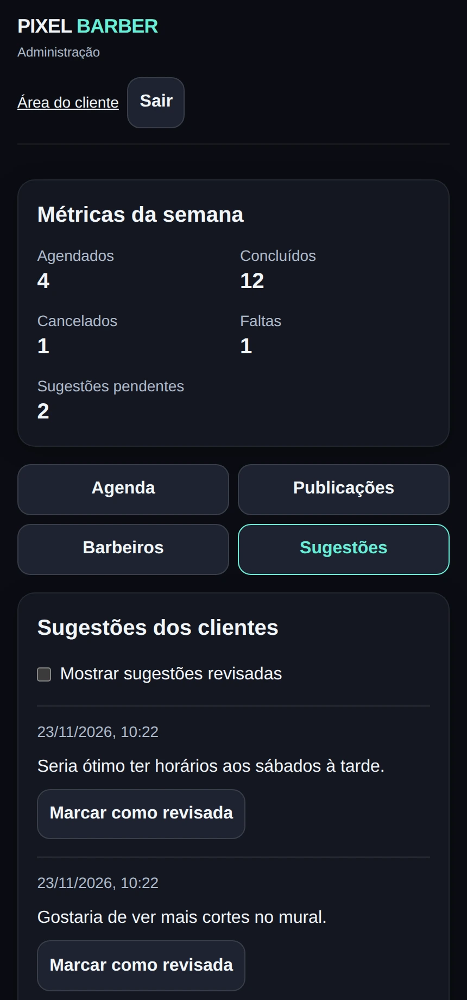

# Pixel Barber

O Pixel Barber é um clube de fidelidade para barbearias. Clientes escolhem o serviço e o barbeiro, reservam um horário e acompanham seus pontos. O Pixel Boy inclui sete minijogos em estilo 16-bit e pode ser jogado sem cadastro.

[Abrir o Pixel Barber](https://pixel-barber.vercel.app) · [Baixar para Android](https://pixel-barber.vercel.app/downloads/pixel-barber-android-debug.apk) · [Guia de instalação em PDF](public/downloads/cartaz-pixel-barber.pdf)

### O que dá para fazer

- Agendar corte, barba ou combo e acompanhar as próximas reservas.
- Acumular pontos, consultar o extrato e trocar pontos por itens para o avatar.
- Ver avisos, álbuns do Mural de Cortes e classificação semanal no mural.
- Gerenciar a agenda, os barbeiros e o mural pelo painel administrativo.

### Telas do app

Capturas da interface web em tamanho de celular com dados fictícios.

| Acesso ao clube | Agendamento | Loja do Avatar |
| --- | --- | --- |
|  |  |  |

| Quadro de avisos e Mural de Cortes | Ranking semanal | Pixel Boy |
| --- | --- | --- |
|  |  |  |

### Projeto

Next.js 14 App Router, TypeScript, Tailwind CSS, Lucide e Supabase. O Capacitor empacota o app para Android e iOS.

```text
src/
  app/
    layout.tsx                 Layout e metadados
    page.tsx                   Rota inicial
    globals.css                Tema arcade e estilos responsivos
  components/auth/
    AuthScreen.tsx             Cadastro, login e perfil de entrada
    AvatarSprite.tsx           Sprites dos quatro avatares
  components/dashboard/
    Dashboard.tsx              Navegação do painel do cliente
    Booking.tsx                Reserva, agenda e cancelamento
    Mural.tsx                  Galeria, pódio e classificação
  lib/
    avatars.ts                 Catálogo de avatares e versão do aceite
    phone.ts                   Normalização de celulares para o Supabase Auth
    booking.ts                 Contratos, datas e horários de Brasília
    demo-booking.ts            Agenda temporária e ranking de exemplo
    supabase/browser.ts        Cliente Supabase e contrato tipado do perfil
    supabase/booking.ts        Consultas e RPCs da agenda e do ranking
supabase/migrations/
  20261121000000_initial.sql   DDL inicial e catálogo de serviços de exemplo
  20261121000001_phone_consent.sql   Atualiza o aceite para o cadastro por celular
  20261121000002_booking_and_leaderboard.sql   Agenda e ranking da Sprint 2
supabase/tests/
  booking_and_leaderboard.sql  Regressões de agenda, cancelamento e ranking
```

## Executar

1. Em um projeto Supabase dedicado ao Pixel Barber, execute as migrações pendentes no SQL Editor, em ordem e uma vez cada. Em um ambiente existente, aplique somente as migrações pendentes.
2. Copie `.env.example` para `.env.local`. Preencha a URL e a chave publicável do projeto.
3. Habilite **Phone** nos provedores de autenticação do Supabase e configure o mínimo de 8 caracteres para a senha. Para validar a titularidade do celular, configure um provedor de SMS e habilite a confirmação por SMS.
4. Com Node.js 22+, rode `npm ci` e `npm run dev`. Acesse `http://localhost:3000`. Use **Criar conta**, informe o celular com DDD, escolha um avatar e aceite os Termos de Uso da Aplicação. Com confirmação habilitada, digite o código recebido por SMS. Nos próximos acessos, use o celular e a senha.
5. **Experimentar demonstração** abre um perfil local com agenda e ranking de exemplo. As reservas de demonstração duram até sair da sessão ou atualizar a página.

`npm run typecheck` verifica a tipagem. `npm run build` gera a compilação de produção.

## Verificação por SMS com TextBee

O Supabase Auth gera e valida o código. O Send SMS Hook encaminha o envio ao TextBee, que usa o chip do Android cadastrado. O cadastro, o reenvio e a alteração de senha por SMS funcionam também nos apps nativos. A alteração está disponível em **Esqueci minha senha** e em **Editar perfil**.

1. Cadastre um Android com chip ativo no TextBee, conceda permissão de SMS e mantenha o aparelho online. Gere uma chave de API e copie o ID do aparelho no painel. [Configuração do TextBee](https://textbee.dev/docs/getting-started/setting-up-textbee)
2. No Supabase, em **Authentication → Hooks**, crie o **Send SMS** do tipo HTTP com a URL do seu ambiente seguida de `/api/auth/send-sms`. Gere o segredo no painel. Ative o hook após publicar o endpoint com as variáveis configuradas. [Send SMS Hook](https://supabase.com/docs/guides/auth/auth-hooks/send-sms-hook)
3. Na Vercel, adicione `SEND_SMS_HOOK_SECRET` com o valor completo gerado pelo Supabase (incluindo `v1,whsec_`), `TEXTBEE_API_KEY` e `TEXTBEE_DEVICE_ID` às variáveis privadas do ambiente. Publique novamente com essas variáveis.
4. No Supabase, habilite o provedor **Phone** e a confirmação por SMS. Use seis dígitos para o código, como na tela de cadastro, e revise os limites de envio de SMS. [Autenticação por celular](https://supabase.com/docs/guides/auth/phone-login)
5. Cadastre um número novo, confirme com o código recebido e entre com celular e senha. Para testar o reenvio, repita com outro cadastro ou solicite outro código antes de confirmar, após o intervalo de envio do Supabase. Se o SMS atrasar, confira o histórico de envio no TextBee e a conexão do Android. [Status de envio no TextBee](https://textbee.dev/docs/sending-sms/sending-sms)

## Administração e pontos

As capturas do painel administrativo usam dados fictícios.

| Agenda | Publicações |
| --- | --- |
|  |  |

| Barbeiros | Sugestões |
| --- | --- |
|  |  |

Aplique `20261123000011_point_expiration_type.sql` e confirme a transação antes de aplicar `20261123000012_club_operations.sql`. Em seguida, aplique `20261123000013_mural_photos.sql`, que provisiona o bucket privado do mural. Aplique também `20261123000014_welcome_points.sql` para creditar 150 pontos ao confirmar o celular de novas contas. Aplique `20261123000015_mural_portfolio.sql` para separar o quadro de avisos do portfólio. Depois, publique a aplicação. Para liberar acesso, crie e confirme uma conta normal, copie o UID em **Authentication → Users** e execute no SQL Editor do Supabase:

```sql
insert into public.club_admins (user_id) values ('UID-DA-CONTA')
on conflict do nothing;
```

Entre em `/admin` com o celular e a senha da conta autorizada. O painel exibe as métricas da semana, a agenda por data, os avisos, os barbeiros e as sugestões enviadas pelo mural. O quadro exibe até dois avisos ativos lado a lado. O Mural de Cortes mostra dois álbuns por vez em cada coluna de barbeiro. Aplique `20261123000019_cut_mural_barbers.sql` para habilitar as colunas e o vínculo dos álbuns. Em **Barbeiros**, adicione o link HTTPS da foto. Em **Publicações → Álbuns**, escolha o barbeiro ao publicar ou vincule um álbum anterior pelo seletor do próprio álbum. Cada álbum pode ter até quatro fotos JPG, PNG ou WebP de 6 MB cada, legenda e a marcação de um cliente pelo avatar. No mural, a marcação mostra o primeiro nome e o avatar. Registre presença e falta depois do horário de término, em ordem de agendamento por cliente.

- O ranking começa às segundas-feiras à meia-noite, no horário de Recife. Ele soma os créditos da semana e desconta as penalidades dos agendamentos daquela semana. Resgates e expirações afetam o saldo da carteira.
- Aplique `20261123000020_barber_delete.sql` para habilitar **Excluir barbeiro** no painel. Cadastros com agendamentos vinculados ficam protegidos contra exclusão.
- A sequência de faltas aplica 20%, 30%, 40% e, a partir da quarta falta consecutiva, 50%, com limite acumulado de 50% por semana. A base são os créditos da semana do agendamento já registrados ao marcar a falta. Uma presença encerra a sequência. O débito na carteira é limitado ao saldo disponível.
- Cada crédito vale 90 dias por padrão. A validade está em `public.club_point_rules.validity_days`. Débitos consomem primeiro os créditos mais antigos. O saldo é atualizado ao entrar, ao voltar ao app, nas consultas periódicas e nas movimentações. A expiração aparece no extrato.

Para testar as regras e as permissões em um banco descartável, execute `psql -v ON_ERROR_STOP=1 -f supabase/tests/club_operations.sql`.

## Contratos do banco

- O celular é o identificador de login. Números brasileiros informados com DDD recebem o prefixo `+55`. Contas anteriores cadastradas só com e-mail precisam ter um celular associado no Supabase Auth para entrar pela nova tela. As credenciais ficam no Supabase Auth. O gatilho grava o nome, o avatar e o aceite versionado, com timestamp do banco. O navegador só pode alterar nome e avatar na tabela de perfis.
- A consulta `get_available_slots` devolve horários de início em blocos de 30 minutos a partir das 09h, com fechamento às 19h no horário de Brasília. A RPC `create_appointment` valida o início e calcula o fim pela duração do serviço. O banco impede sobreposições tanto para o barbeiro quanto para o cliente. A RPC `cancel_appointment` exige titularidade e aceita cancelamentos com pelo menos 15 minutos de antecedência.
- A RPC paginada `get_leaderboard` mostra posição, primeiro nome, avatar e pontos da semana aos clientes autenticados. A agenda só mostra ao cliente os próprios agendamentos.
- A RPC `post_points` é restrita ao backend. Ela serializa alterações por cliente e usa uma chave de evento para evitar créditos ou débitos duplicados. A penalidade de falta usa até o saldo disponível. As regras de expiração, resgate e presença são aplicadas no banco.
- Produtos físicos têm preço em reais e cosméticos têm preço em pontos. Os carrinhos, o checkout e o suporte ficam para as próximas entregas.
- Os Termos de Uso da Aplicação ficam em `/termos`. Aplique `20261123000017_app_terms.sql` para registrar a versão atual dos termos no perfil. O cadastro mantém a compatibilidade com o backend anterior durante a publicação.

## Validação da Sprint 2

Execute `psql -v ON_ERROR_STOP=1 -f supabase/tests/booking_and_leaderboard.sql` em um banco descartável com as migrações aplicadas. O teste usa uma transação revertida no final e cobre conflito de reservas, sobreposição, titularidade, cancelamento e paginação do ranking.

Antes de publicar uma compilação da Sprint 2 na Vercel, aplique a migração da agenda no Supabase usado nesse ambiente.

## Sprint Arcade

O painel **Pixel Boy** reúne sete estações de uma aventura na barbearia. Cada missão tem uma meta própria e a conclusão é salva no aparelho para contas cadastradas. As estações podem ser jogadas em qualquer ordem. Use **Jogar Pixel Boy sem conta** na tela inicial para abrir os jogos no modo demonstração. **Histórico de partidas** mostra as partidas concluídas dos cartuchos, inclusive as que ficaram sem crédito. Aplique `20261123000016_arcade_history.sql` para ver as partidas da conta e gravar o placar completo das novas partidas. O histórico anterior mantém os dados que já estavam registrados. A demonstração roda sem Supabase e mantém os recordes durante a sessão local.

O servidor inicia cada partida com uma semente e associa a sessão à conta autenticada. Ao fim, a API recebe os comandos e reproduz a partida a 60 passos por segundo para calcular o placar. O PostgreSQL compara a duração simulada ao tempo decorrido, salva a melhor marca e credita até três partidas com placar positivo por dia no horário de Brasília. O crédito e o lançamento no ledger são atômicos e o reenvio da mesma partida não duplica pontos. A reprodução verifica a coerência dos comandos, mas um bot ainda pode jogar seguindo as regras.

Para publicar, aplique primeiro as migrações pendentes até `20261121000006_new_retro_games.sql`. Configure `SUPABASE_SECRET_KEY` como variável exclusiva do servidor na Vercel e em `.env.local` para desenvolvimento com a API real. A API também aceita `SUPABASE_SERVICE_ROLE_KEY` em projetos com chaves legadas. As variáveis públicas do Supabase permanecem as mesmas.

Execute `psql -v ON_ERROR_STOP=1 -f supabase/tests/arcade.sql` em um banco de teste migrado para verificar duração inválida, titularidade, teto diário, recorde na quarta partida, reenvio, saldo e ranking.

### Pixel Boy e dificuldade

Selecione um cartucho e escolha **Iniciante (1,0×)**, **Experiente (1,5×)** ou **Mestre (2,5×)**. Use **SELECT** ou **Shift** para alternar e **START** ou **Enter** para começar. As setas movem o personagem nos cartuchos direcionais. **X** ou **Espaço** acionam o botão específico do cartucho.

O servidor reconstitui a partida para validar o placar. Os registros antigos e as conquistas foram preservados. Bombas de Espuma e Órbita Pixel compartilham o recorde online da categoria de ação. Todos os cartuchos compartilham o limite diário de três partidas creditadas. A base de crédito é um ponto a cada 50 no placar, arredondada para cima e limitada a 15. Com o bônus de login, o crédito final fica limitado a 20 pontos por partida. Os recordes históricos exibem os valores já registrados.

## Loja do Avatar

A aba **Loja** mostra o saldo em pontos, o provador e o guarda-roupa. A coleção tem 65 itens, incluindo 30 peças de moda. Camisas e vestidos, shorts e bermudas, bonés e tênis podem ser combinados no provador. A camisa do River Plate permite escolher um número de 0 a 99 e salvá-lo após o resgate. Os acessórios antigos adquiridos aparecem no guarda-roupa. O resgate equipa o item automaticamente. É possível desequipar e reequipar itens adquiridos sem custo. Cada espaço do avatar aceita um item equipado por vez. O mural e a classificação mostram os acessórios equipados.

Os **Exclusivos de lançamento** podem ser resgatados por 90 dias a partir da aplicação da migração `20261123000021_launch_redemption_window.sql`, enquanto houver estoque. Os itens resgatados continuam disponíveis no guarda-roupa depois do fim da campanha.

| Exclusivo de lançamento | Pontos |
| --- | ---: |
| Tesoura Prisma | 1.100 |
| Chapéu do Fundador | 1.250 |
| Avental Primeira Edição | 1.400 |
| Trono da Inauguração | 1.600 |
| Aura Letreiro Neon | 1.850 |

Aplique `20261121000005_avatar_store.sql`, `20261122000007_avatar_collection.sql`, `20261122000008_launch_collection.sql`, `20261122000009_avatar_fashion.sql` e `20261122000010_avatar_shirt_number.sql` na ordem das migrações. O endpoint `POST /api/store/avatar/buy` aceita apenas `product_id` e usa a sessão do cliente. O banco consulta preço e estoque do catálogo e registra o débito, a aquisição e o equipamento na mesma transação. A demonstração usa 1.000 PTS fictícios e guarda as compras até sair ou atualizar a página.

Para validar as regras da loja em um banco descartável, execute `psql -v ON_ERROR_STOP=1 -f supabase/tests/avatar_store.sql` após aplicar as migrações.

## Instalação e empacotamento mobile

### PWA

Em produção, abra o site HTTPS. No Chrome para Android, use **Instalar aplicativo** no menu. No Safari para iPhone, use **Compartilhar → Adicionar à Tela de Início** e abra pelo novo ícone. O app inicia em modo standalone. O service worker oferece uma tela de reconexão ao abrir offline e não armazena respostas de autenticação, compras ou pontos.

### Android e iOS

1. Rode `npm ci`, configure as variáveis públicas do Supabase em `.env.local` e execute `npm run build:mobile`.
2. No Android, abra `android/` no Android Studio com JDK 21 e Android SDK Platform 36. Para um APK de teste, rode `./gradlew assembleDebug` dentro de `android/`.
3. No iOS, abra `ios/App/App.xcodeproj` no Xcode em um Mac, selecione a equipe de assinatura e execute em aparelho ou simulador. O projeto usa Swift Package Manager.
4. Para apontar o pacote nativo a um ambiente HTTPS diferente da Vercel de produção, defina `NEXT_PUBLIC_BACKEND_ORIGIN` ao executar `npm run build:mobile`. Use a URL e a chave publicável do mesmo projeto Supabase configurado nesse backend.

O build mobile exporta a interface para `out/` e sincroniza as plataformas pelo Capacitor. Os endpoints de pontuação e resgate continuam no servidor Next.js, e a chave secreta do Supabase continua no ambiente do servidor. Antes de distribuir o app, aponte para um backend publicado com as migrações necessárias.

### Builds automáticos para iOS

A cada envio à branch `main`, o workflow **Build iOS** exporta a interface atual, sincroniza o Capacitor e compila o app para o simulador. A compilação também pode ser iniciada manualmente na aba **Actions**. Baixe o artefato `pixel-barber-ios-simulator` na execução correspondente. Para atualizar apenas o projeto iOS local, use `npm run build:ios`.

Nas variáveis do repositório em **Settings → Secrets and variables → Actions → Variables**, configure `NEXT_PUBLIC_SUPABASE_URL` e `NEXT_PUBLIC_SUPABASE_PUBLISHABLE_KEY` para habilitar as contas reais no build. Sem essas variáveis, a demonstração continua disponível. `NEXT_PUBLIC_BACKEND_ORIGIN` é opcional e usa a origem de produção padrão quando omitida. O catálogo para contas reais depende das migrações aplicadas no Supabase.

A distribuição para iPhones pelo TestFlight ou pela App Store exige um build assinado com uma equipe Apple e envio ao App Store Connect. O artefato automático é para o simulador.

O feedback háptico usa os motores nativos no Android e iOS. No PWA, funciona quando o navegador oferece a API de vibração. No Safari para iOS, esse feedback depende do pacote nativo.

### Sete cartuchos em estilo 16-bit

Bombas de Espuma, Salto de Pomada, Órbita Pixel, Ruínas da Navalha, Itens do Salão e Torre de Neon têm mecânicas e controles próprios. Bigode Snake mantém o crescimento da cauda e as loções douradas, com nova arte e mais tempo para a primeira direção. Bombas de Espuma e Ruínas da Navalha usam o avatar e os cosméticos equipados. Em Itens do Salão, só são aceitas trocas entre vizinhos que formem uma linha de três ou mais itens iguais.

As referências do briefing orientam a jogabilidade dos cartuchos, com arte, mapas e personagens da barbearia.

- **Bombas de Espuma** usa bombas temporizadas, caixas destrutíveis e robôs. A referência de plataforma e robôs do PDF deu lugar à arena solicitada na revisão. [Mega Man: The Wily Wars](https://en.wikipedia.org/wiki/Mega_Man:_The_Wily_Wars) · [Konami](https://www.konami.com/games/asia/en/topics/572/)
- **Salto de Pomada** pede passar pelos aros para liberar o portão. [Bounce](https://en.wikipedia.org/wiki/Bounce_(video_game_series))
- **Órbita Pixel** combina nave lateral, ondas de inimigos e cápsulas de tiro triplo. [Space Impact](https://en.wikipedia.org/wiki/Space_Impact)
- **Ruínas da Navalha** combina exploração do depósito e perseguição em labirinto. [Diamond Rush](https://en.wikipedia.org/wiki/Diamond_Rush) · [Guia da Bandai Namco](https://www.namcogames.com/_guides/User_Guide_-_PAC-MAN_Plus_by_Namco.pdf)
- **Itens do Salão** anima a troca, destaca a linha e doura as casas completadas. [Jewel Quest II](https://www.iwin.com/games/jewel-quest-ii?from=home)
- **Torre de Neon** usa um cabo móvel e premia quedas alinhadas. [Tower Bloxx](https://en.wikipedia.org/wiki/Tower_Bloxx)

A migração `20261121000006_new_retro_games.sql` deve estar aplicada. Os motores antigos continuam disponíveis para validar partidas iniciadas por versões anteriores do app.

### Login diário e extrato

A primeira abertura autenticada do dia conta para a sequência, pelo horário de Recife. O bônus começa em 1× e aumenta 0,1× a cada dia consecutivo até 1,5×. Um dia sem acesso reinicia a sequência. O servidor guarda o progresso no Supabase Auth e aplica o multiplicador somente ao crédito do Pixel Boy do dia. Toque no saldo do cabeçalho para consultar os créditos e débitos da conta.

### Atualizações do app

O PWA consulta a versão publicada ao abrir, voltar ao primeiro plano e a cada minuto com o app aberto. Quando encontra uma versão nova, mostra **Atualizar agora**; a próxima abertura online também carrega a publicação atual. O service worker continua usando a rede para a página e as APIs, e guarda somente a tela offline.

No Android nativo, o app compara o código de versão instalado com `GET /api/release` e mostra o link da versão mais recente. O Android pede confirmação para instalar um APK fora da loja. O pacote exige Android 7.0 ou superior (API 24) e usa o Android System WebView do aparelho.

Para preparar uma atualização, incremente `androidVersionCode` e atualize `androidVersionName` em `src/lib/device/release.json`. Rode `node scripts/build-mobile.mjs` e `npx cap sync android`. Compile com `./gradlew assembleRelease` em `android/`, alinhe o APK com `zipalign` e assine com o mesmo certificado da versão distribuída para preservar a atualização sobre instalações existentes. O arquivo público mantém o caminho `public/downloads/pixel-barber-android-debug.apk` usado nos links e no cartaz.

Antes de publicar o APK e os metadados juntos, teste instalação limpa e atualização sobre a versão anterior em um aparelho. Confirme abertura, login por SMS, agendamento e Pixel Boy. Confira o layout no Android 16 com as barras de navegação do sistema.
